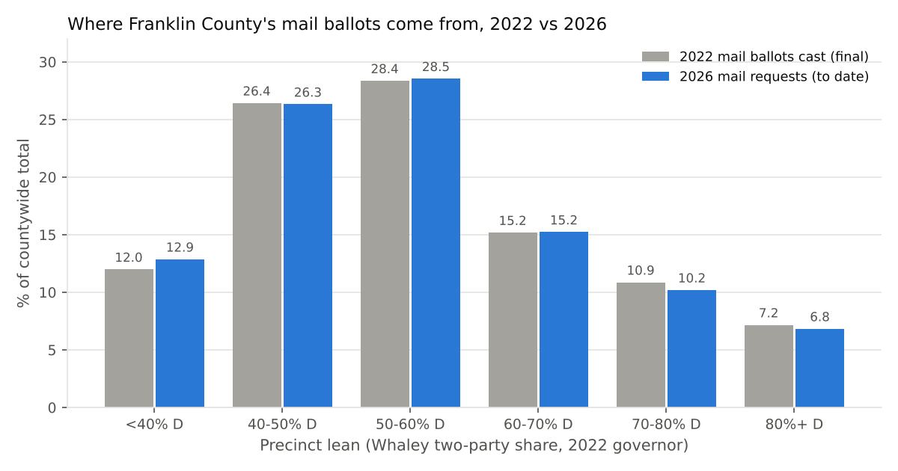
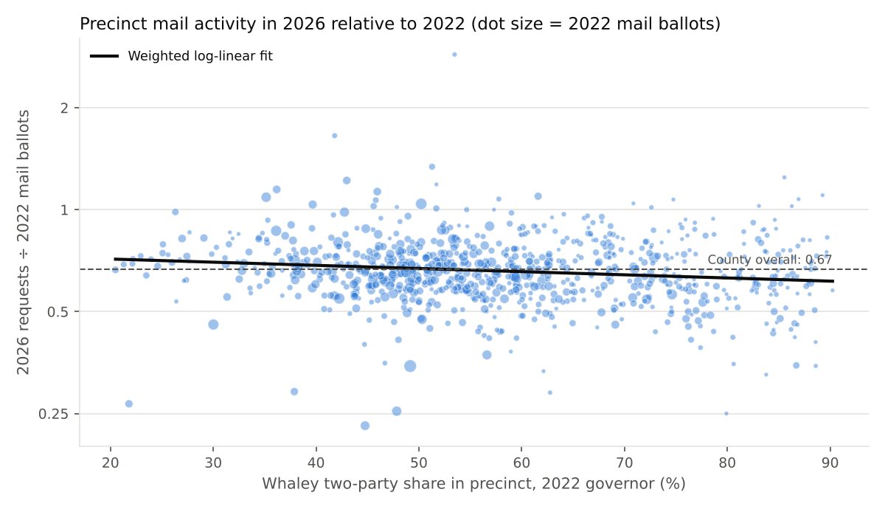
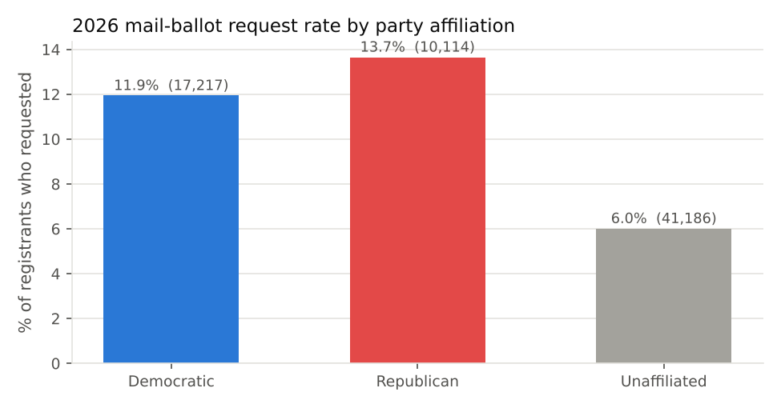
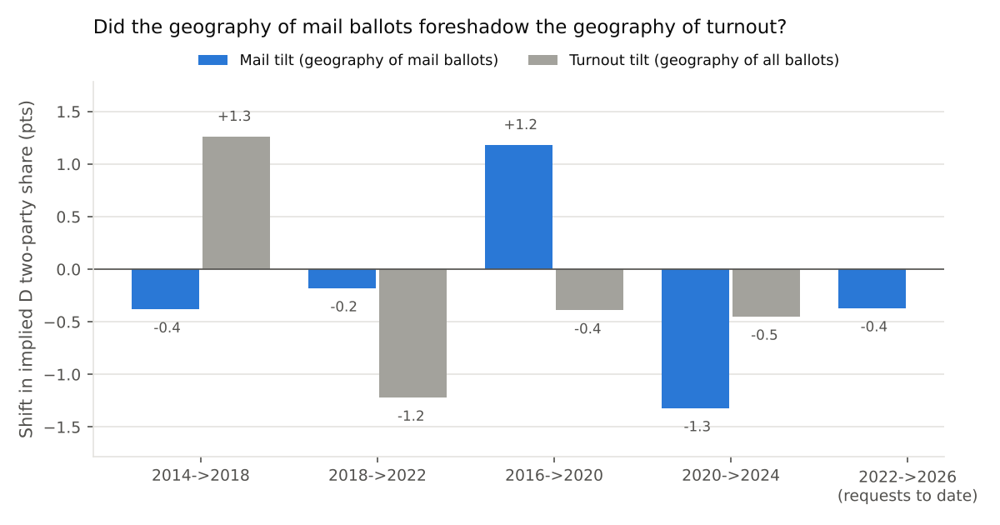
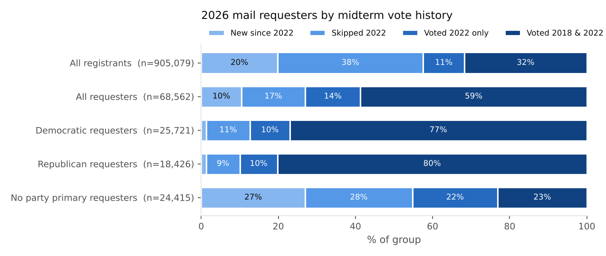
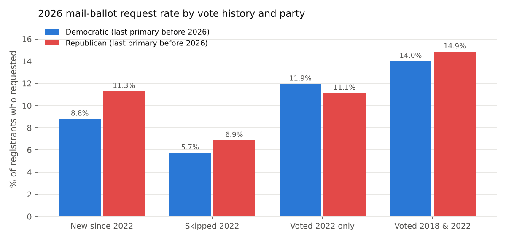
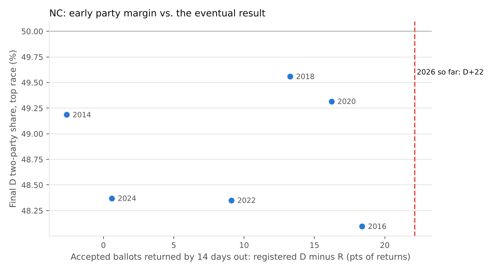

# Early vote analysis 2026: Ohio (Franklin County) precinct VBM, plus multi-state checks

Compares precinct-level vote-by-mail (VBM) activity in the **November 2022** and
**November 2026** general elections, and how the change varies with precinct partisanship.

**As of:** 2026 mail-ballot requests received through **Oct 5, 2026**. Ballots started going
out Oct 6, so no 2026 ballots have been returned yet.

## Scope: why only Franklin County

No statewide precinct-level absentee file exists for Ohio. The Secretary of State publishes only
county totals, and its site returned HTTP 403 from this environment. Each county board of
elections publishes (or doesn't publish) its own files. **Franklin County** (Columbus, ~905k
registrants, the state's largest county) has both pieces needed:

| Need | Source |
|---|---|
| 2026 mail requests, one row per voter, with precinct and party affiliation | Franklin BOE *Absentee by Mail Voter List (Current Election)* |
| 2026 registration by precinct and party | Franklin BOE countywide `VOTERFILE.TXT` |
| 2022 mail ballots by precinct, with candidate votes | Franklin BOE 2022 General *Official Results, Precinct Detail (XLSX)*, split by vote type (mail absentee / in-office absentee / election day / provisional) |

The voter file's vote-history columns record *whether* someone voted, not *how*. So the 2022 side
has to come from the precinct canvass.

## Method

- **Precinct match:** 2022 names ("COLUMBUS 01-A") are normalized to 2026 abbreviations ("COLS 1-A").
  876 precincts match. 8 exist only in 2022 and 13 only in 2026. 855 of the matched precincts have
  stable boundaries, meaning 2026 registration is within 0.67–1.5× of 2022 registration. Every
  result below holds when the analysis is limited to those 855.
- **Partisanship:**
  - *Precinct lean* is Whaley's two-party share in the 2022 governor race, counting all ballots.
  - *Voter party* is the BOE affiliation code. In Ohio this comes from the voter's most recent
    partisan primary ballot. Most voters are "U" (unaffiliated).
- **Comparison:** 2026 requests to date are compared with 2022 final mail ballots cast. The two
  counts are at different stages, so the analysis looks at **relative** shifts: each lean group's
  share of the countywide total, and each precinct's ratio of 2026 requests to 2022 mail ballots
  compared with the county ratio (0.67). If requests in all precincts mature at the same pace,
  these relative measures are unbiased.

## Findings



| Precinct lean (2022 gov, D two-party) | Precincts | 2022 mail ballots | 2026 requests | Share 2022 | Share 2026 | Change (pts) | 2026 req ÷ 2022 mail |
|---|---:|---:|---:|---:|---:|---:|---:|
| <40% D | 93 | 12,100 | 8,641 | 12.0% | 12.9% | **+0.9** | 0.71 |
| 40–50% D | 184 | 26,670 | 17,675 | 26.4% | 26.3% | −0.1 | 0.66 |
| 50–60% D | 223 | 28,620 | 19,167 | 28.4% | 28.5% | +0.2 | 0.67 |
| 60–70% D | 153 | 15,322 | 10,226 | 15.2% | 15.2% | +0.1 | 0.67 |
| 70–80% D | 113 | 10,967 | 6,847 | 10.9% | 10.2% | **−0.7** | 0.62 |
| 80%+ D | 110 | 7,232 | 4,590 | 7.2% | 6.8% | **−0.3** | 0.63 |
| **County (matched)** | 876 | 100,911 | 67,146 | | | | **0.67** |

1. **There is a small but statistically real shift toward Republican-leaning precincts.** The
   reddest precincts (<40% D) have already reached 71% of their 2022 mail-ballot volume. The
   bluest precincts (70%+ D) are at 62–63%. Across precincts:
   - Spearman ρ between lean and log(2026 requests ÷ 2022 mail ballots) is −0.12 (p < 0.001).
   - The weighted fit implies a ratio of about 0.70 in a 30% D precinct and 0.62 in an 85% D
     precinct, roughly a 12% relative gap.
   - Bootstrap 95% CI for the slope: −0.010 to −0.032 log points per +10 pts D.
   - The pattern is the same using 2026 voter-file affiliation as the lean measure.

   

2. **The effect on the mail electorate's partisan makeup is small.** Suppose each precinct's 2022
   mail ballots voted the same way in 2026 but came in 2026-request proportions. Whaley's share
   of the mail vote would move from **57.3% to 57.0%** (−0.4 pts). The geographic shift is real but
   only worth tenths of a point.

3. **Among people who have a partisan affiliation, Republicans are requesting mail ballots at a
   higher rate than Democrats** (2026 to date, countywide):

   | Affiliation | Registered | Requests | Request rate | Share of requests |
   |---|---:|---:|---:|---:|
   | Democratic | 144,190 | 17,217 | 11.9% | 25.1% |
   | Republican | 74,092 | 10,114 | **13.7%** | 14.7% |
   | Unaffiliated | 685,762 | 41,186 | 6.0% | 60.0% |

   

   D-affiliated voters still outnumber R-affiliated requesters about 1.7 to 1. The share of
   requests from D-affiliated voters climbs steadily with precinct lean, from 19% in the reddest
   group to 38% in the bluest, and the R share falls from 21% to 4%. There's no 2022 voter-level
   list to compare against, so this part is a 2026 snapshot only.

### Bottom line

Franklin County mail activity in 2026 is running about two-thirds of 2022's final mail-ballot
volume at the start of voting. The gap is somewhat smaller in Republican-leaning precincts than in
heavily Democratic ones: red precincts are slightly over-represented relative to 2022, and the
bluest urban precincts are slightly under-represented. The size of the shift is modest, about
1 point of county share at each end. Statewide, mail voting has been falling as a share of early votes. In the May 2026 primary, mail
was 38% of early votes, down from 52% in May 2022. This county's data shows that drop is slightly
steeper in Democratic areas. **It is not evidence of a large partisan swing in turnout.**

## How predictive is this? A backtest, 2014–2024

To judge whether the 2026 pattern means anything for the result, I ran the same measurement on
every earlier pair of comparable Franklin County general elections: midterm to midterm, and
presidential to presidential. Each year's precinct results split by voting method are published
by the BOE (`scripts/backtest_franklin.py`). The backtest is generous to the indicator because it
uses *final* mail ballots for both years, not requests four weeks out.

Each pair is scored on three measures:

- **Mail tilt.** How far the precincts that cast mail ballots shifted toward D or R precincts. This
  is the same −0.4-point "composition shift" computed for 2026.
- **Turnout tilt.** The same calculation applied to *all* ballots: how far overall turnout shifted
  toward D or R precincts.
- **Actual swing.** The change in the county's D two-party share at the top of the ticket.

| Pair | Mail tilt | Turnout tilt | Actual swing (D two-party) | Precinct lean vs mail change (ρ) | Precinct mail change vs turnout change (ρ) |
|---|---:|---:|---:|---:|---:|
| 2014 → 2018 (gov) | −0.4 | **+1.3** | **+23.3** | −0.12 | 0.53 |
| 2018 → 2022 (gov) | −0.2 | −1.2 | −8.1 | −0.13 | 0.50 |
| 2016 → 2020 (pres) | **+1.2** | −0.4 | +2.2 | +0.37 | 0.34 |
| 2020 → 2024 (pres) | −1.3 | −0.5 | −1.6 | −0.58 | 0.47 |
| **2022 → 2026 (requests to date)** | **−0.4** | ? | ? | **−0.12** | ? |



What the backtest shows:

1. **The 2026 pattern is what midterms usually look like here.** In both earlier midterm pairs,
   mail activity shifted toward R-leaning precincts by almost exactly the same amount as now:
   ρ = −0.12 and −0.13, against −0.12 in 2026, with mail tilts of −0.4 and −0.2. The outcomes of
   those two pairs were opposite. In 2018 Democrats gained 23 points countywide and turnout tilted
   toward D precincts. In 2022 they lost 8 points. A signal that looked the same before a D wave
   and before a D slump can't distinguish between them.
2. **Mail tilt got the direction of turnout tilt right only 2 times out of 4.** In 2014→2018 and
   2016→2020 it pointed the wrong way. Where it was right, its size was off by a factor of 3 to 7.
   Precinct-level changes in mail ballots do partly track changes in turnout (ρ ≈ 0.3–0.5). That
   relationship is too noisy, and too mixed up with people switching between voting methods, to
   read a direction from.
3. **Even a perfect read of turnout geography would explain little of the outcome.** Turnout
   tilts ranged from −1.2 to +1.3 points. Actual swings ranged from −8 to +23. Swings are driven by
   persuasion, the candidates, and the national environment. Mail is also only 21–24% of ballots
   in non-pandemic years.
4. **The mail vote's raw partisanship isn't a stable baseline either.** The D share of the mail
   vote minus the D share overall was −4 (2014), −6 (2018), +8 (2020), 0 (2022), and +3 (2024).
   It swings with each party's message about voting by mail, so "D share of mail ballots" can't be
   read on its own.

| Year | Mail % of ballots | D share overall | D share of mail | Gap |
|---|---:|---:|---:|---:|
| 2014 | 29.4% | 41.7% | 37.7% | −4.1 |
| 2016 | 24.0% | 63.8% | 60.2% | −3.6 |
| 2018 | 21.3% | 65.1% | 59.1% | −6.1 |
| 2020 | 40.5% | 66.0% | 74.2% | +8.3 |
| 2022 | 23.7% | 57.0% | 57.2% | +0.2 |
| 2024 | 20.9% | 64.4% | 67.4% | +3.0 |

**Assessment: the 2022→2026 precinct shift has close to no predictive value for the outcome.**
Its size (−0.4 pts) matches the noise floor, and its direction matches what came before both a D
wave and a D slump. The party-affiliation request rates (R 13.7% vs D 11.9%) have no historical
counterpart to calibrate against. Ohio's affiliation codes also move with each primary's turnout,
so the R–D gap may reflect who happened to vote in a primary, and their voting-method habits,
more than enthusiasm. Better signals for
the result:
- 2026 *returned* ballots and early in-person votes measured against 2022 at the same day before
  the election.
- How many of each year's early voters are new or infrequent voters (from vote history). Changes
  in turnout composition show up there, while mail-versus-in-person mostly reflects habit.
- Polling. In the backtest, the actual swing was 3 to 18 times larger than the turnout-geography
  effect in every pair.

## Follow-up checks (run Oct 6, 2026)

### 1. Returned ballots and early in-person votes against 2022: not possible yet

Today is the first day of voting. Franklin's in-person early-vote list is still empty. The
mail list shows 126 returned ballots, which are military/overseas ballots sent Sept. 18. There's
also no public 2022 baseline for the same point in the calendar: the BOE only posts the
current election's list, and the state's daily county reports couldn't be reached from here.
This becomes possible if the daily 2026 lists are saved going forward and compared with 2022
county totals at the same number of days out.

### 2. Who the 2026 mail requesters are, by vote history (`scripts/propensity_2026.py`)

Requests were linked to the voter file (68,562 of 68,620 matched on county voter ID). Every
registrant was then sorted into one of four midterm vote-history groups:

- **New since 2022:** registered after the 2022 general.
- **Skipped 2022:** registered in time for 2022 but didn't vote.
- **Voted 2022 only:** voted in 2022 but not 2018.
- **Voted 2018 & 2022:** habitual midterm voter.

Party here is each voter's **last D or R primary before 2026**. Using the current label would be
circular: taking a 2026 primary ballot is itself a sign of engagement, and Franklin's 2026
primary drew 122k D ballots against 50k R.



- **Requesters are mostly habitual voters, as mail requesters usually are.** 59% voted in both
  2018 and 2022, compared with 32% of all registrants. Only 27% are new since 2022 or skipped
  2022, compared with 58% of registrants.
- **Among voters with a partisan primary history, Republicans are drawing in slightly more
  low-propensity voters.** Within each vote-history group, here is the share of registrants who
  requested a mail ballot:

  | Vote history | D request rate | R request rate | R ÷ D |
  |---|---:|---:|---:|
  | New since 2022 (3.9k D / 2.1k R registrants) | 8.8% | 11.3% | 1.28 |
  | Skipped 2022 (50.7k D / 23.5k R) | 5.7% | 6.9% | 1.20 |
  | Voted 2022 only | 11.9% | 11.1% | 0.93 |
  | Voted 2018 & 2022 | 14.0% | 14.9% | 1.06 |

  

- **The same pattern appears by precinct lean, which doesn't depend on party labels.** Compare
  infrequent voters' request rate with habitual voters' rate in the same precincts. The ratio
  falls steadily from Republican to Democratic areas:

  | Precinct lean | Skipped 2022 rate ÷ habitual rate | New since 2022 rate ÷ habitual rate |
  |---|---:|---:|
  | <40% D | 0.26 | 0.34 |
  | 40–50% D | 0.28 | 0.41 |
  | 50–60% D | 0.25 | 0.31 |
  | 60–70% D | 0.24 | 0.28 |
  | 70–80% D | 0.21 | 0.25 |
  | 80%+ D | 0.18 | 0.15 |

**How to read this.** On its face, infrequent voters in Republican areas and with Republican
primary histories are slightly more engaged with *mail* so far. Three things weaken that as a
turnout signal:

- **Where the low-propensity voters are.** The bluest precincts are dense, young, high-turnover
  Columbus neighborhoods, including the OSU campus area. Many "new" and "skipped" registrants
  there are students and renters, who use mail less and in-person voting more, and some have
  out-of-date addresses. That lowers their mail rate regardless of enthusiasm.
- **No 2022 equivalent to compare with**, so this can't show whether the gap is bigger or smaller
  than usual. The backtest above showed mail patterns leaning R-ward in previous midterms too.
- **Mail requests are only part of early voting.** Whether low-propensity Democrats are showing
  up will appear in the in-person early vote, which started today.

The most useful next step is to save the daily mail and in-person lists, then repeat this
vote-history breakdown on **ballots actually cast** each week. That shows whether infrequent
voters' share of early votes is rising in D or R areas as Election Day approaches.

## Multi-state early vote: what can realistically be read from it? (Oct 14, 2026)

By mid-October, outlets are reporting signs of a Democratic early-vote edge across many states.
Two checks below use public voter-level files to test how much those readings can bear.

### North Carolina: same-day comparison and a 2014–2024 backtest (`scripts/nc_early_vote.py`)

NC publishes a statewide voter-level absentee file with party registration and return dates. Each
past election's final file therefore rebuilds the early electorate at **any** number of days
before Election Day. Requests are confidential until a ballot is returned, so accepted *returns*
are the measure. 2026 data run through **21 days out**.

| Year | Returns by day −21 | % D | % R | % Unaff. | D − R | Final top-race D two-party share |
|---|---:|---:|---:|---:|---:|---:|
| 2014 | 10,334 | 41.4 | 37.0 | 21.6 | +4.4 | 49.2 (Senate) |
| 2016 | 49,866 | 35.2 | 39.2 | 25.5 | −4.0 | 48.1 (Pres) |
| 2018 | 13,977 | 43.6 | 26.2 | 30.3 | +17.4 | 49.6 (Sup. Ct.) |
| 2020 | 516,452 | 50.8 | 17.9 | 31.2 | +32.9 | 49.3 (Pres) |
| 2022 | 43,638 | 49.5 | 16.7 | 33.8 | +32.8 | 48.4 (Senate) |
| 2024 | 67,224 | 37.3 | 27.1 | 35.6 | +10.1 | 48.4 (Pres) |
| **2026** | **29,469** | **44.6** | **16.7** | **38.7** | **+28.0** | ? |



- **At equal days out, NC 2026 is *less* Democratic than 2022, not more.** Returns are down 32%.
  The D share is 44.6% against 49.5%, the R share is flat, and unaffiliated voters make up the
  difference. The Democrat-friendly reading (NBC News: D return *rate* up from 17% to 22%) comes from fewer
  Democratic requests, which is the shift away from mail that NBC describes.
- **The early D − R margin has almost no relationship to the outcome.** At day −21 it ranged
  from −4 to +33. The final result moved only between 48.1% and 49.6% D. 2020 and 2022 had
  nearly identical early margins (+33) and different results. Correlation across six elections
  is 0.31, and across the three midterms it's −0.71 (the wrong sign).
- **Changes from one cycle to the next are too noisy to use.** The day −21 margin moved 13–37
  points between comparable elections, while results moved 0.4–1.2 points. The direction matched
  the result's direction 3 of 4 times.
- **The full early vote isn't much better.** It was 42–85% of all votes cast. Its D − R margin fell
  every cycle (−3 to −6 points), whether Democrats gained or lost: registration drift (D → unaffiliated,
  R gains) moves faster than results do. The correlation with the outcome is 0.45 over six points.

### Ohio: how much of "more Democratic than 2024" is relabeling? (`scripts/ohio_label_artifact.py`)

Ohio has no party registration. Franklin's party code is the voter's **2026 primary ballot,
otherwise their 2024 one** (this rule reproduces 99.7% of codes). In October 2024 the same rule
used the 2024 primary, otherwise 2022. Below, the **same 21,551 Franklin voters** who have cast
2026 ballots (returned mail plus early in-person, through Oct 12) are labeled both ways:

| Group | Ballots | D − R, current labels | D − R, Oct-2024 labels | Relabeling only |
|---|---:|---:|---:|---:|
| All ballots cast | 21,551 | D+39.1 | D+27.1 | **+12.0** |
| Early in-person | 15,983 | D+47.3 | D+33.8 | +13.4 |
| Mail returned | 5,568 | D+15.6 | D+7.6 | +8.0 |

2,595 of these voters had no partisan primary in 2022–24 but took a **Democratic 2026 primary
ballot**, so they are now coded D. Only 326 moved the same way to R. That relabeling reflects the
2026 primary's turnout (122k D vs 50k R ballots in Franklin), not a change in who is voting
early. Part of it is genuine engagement, since these people voted in a primary, but it is
counted again as a "more Democratic electorate." **In Franklin, about 12 points of any
"N points more Democratic than 2024" comparison is this artifact, before anything else.** It is
also a presidential-to-midterm comparison, which mixes different electorates. Statewide numbers
need their own check, but the mechanism applies in every county.

### What can realistically be learned

**Reasonably informative:**
- **Turnout volume and where it comes from, compared with the same day in a comparable past
  election.** This is especially useful in states that report by precinct or county. It tells
  you where *participation* is up. Even this lags, and mode shifts distort it.
- **The share of early voters who are new or infrequent voters**, by party or area, compared
  with the same day in the previous cycle. Of all early-vote measures, this one comes closest to
  reflecting enthusiasm, because habitual voters vote no matter what. It needs voter files with
  history, which NC, PA, FL, NV and GA provide.
- **Late in early voting** (the final weekend), when early votes are 50–80% of the total in states
  like NC, GA, NV and AZ, the electorate's *composition* is mostly fixed. Even then it reflects
  composition, not vote choice.

**Not informative (and frequently misread):**
- Party-registration margins of early ballots, compared across years. Mode habits (mail in
  2020, R adoption in 2024, D drift back to in-person in 2026), registration drift and Ohio-style
  primary labels move these numbers far more than outcomes move.
- Early D − R margins as a forecast of the winner. Unaffiliated voters are 35–40% of NC returns
  and lean differently each cycle. The early vote reveals nothing about persuasion, and in the
  backtests above the actual swing was 3 to 18 times larger than any change in turnout makeup.

**Bottom line:** Pooled across states, early vote data can show where turnout is up and whether
low-propensity voters are being reached. It can't reliably say who is winning. Where it can be
checked against the same point in a past election (NC), 2026 doesn't show the Democratic surge
the early headlines suggest. Where headlines rely on party labels (Ohio), much of the apparent
shift is an artifact of the labels.

## Update, Oct 21, 2026: in-person early voting under way (NC, NV)

**North Carolina, 14 days out** (`scripts/nc_early_vote.py`, which now ignores a few mis-dated
records when setting the cutoff). In-person early voting began on the same calendar day in 2022
and 2026 (19 days out), so this is a like-for-like comparison:

| Same day (−14) | Ballots | D | R | Unaff. | D − R |
|---|---:|---:|---:|---:|---:|
| 2018 | 719,940 | 311,739 | 216,216 | 191,985 | +13.3 |
| 2022 | 668,913 | 266,420 | 205,606 | 196,887 | +9.1 |
| 2024 | 1,722,969 | 594,337 | 584,072 | 544,560 | +0.6 |
| **2026** | **924,159** | **404,913** | **200,563** | **318,683** | **+22.1** |

- Compared with 2022: D ballots are up 52%, unaffiliated up 62%, and **R ballots down 2.5%**. The
  shift from mail to in-person explains very little of this: D mail ballots are down only
  about 13k, while D in-person is up about 152k.
- This is the first large, same-day signal this cycle. The backtest still applies. At 14 days
  out, the change in D − R margin pointed the right way in 2 of 3 comparable pairs, and was 3.5 to
  16 times larger than the change in the result. Read literally, +13 points of early margin
  would mean about 1 to 4 points of D improvement over 2022. That range is wide and only
  illustrative.
- Main alternative explanation: **when people vote, not whether they vote.** Democrats may be
  shifting from Election Day to early voting, and Republicans may be waiting for Election Day.
  Republicans' raw early ballots are flat, not down, which fits either reading. The
  vote-history check (are the extra D/unaffiliated early voters people who skipped 2022?)
  would distinguish them. It needs NC's statewide vote-history file.

**Nevada** (from the Nevada Independent blog's published numbers, through Oct 21, about 18% of
expected turnout):
- Statewide D+4 to D+5 on about 195k ballots. Mail is D+9, in-person R+3.
- **Clark looks like 2022; Washoe is where it's better.** Clark's first-weekend combined early
  vote in 2022 was about 58k ballots at D+13. 2026 is about 71k at roughly D+11 (mail D+14,
  in-person D+4 to D+6, both estimated). That's a similar raw lead on more ballots. Washoe is
  D+8 to D+9, against less than half that at the same point in 2022, and Washoe is
  overrepresented (21–23% of ballots against 16% of registrants).
- Votes are moving between methods: about 1 in 4 of 2022's in-person voters now vote by mail,
  and that group leans R. Clark mail is less D than in 2022 (D+14 against about D+23), and
  in-person is much less R (D+6 on Day 1, against R+8). Comparing one method at a time is
  misleading. Only combined totals are comparable.
- Best enthusiasm signal in the blog: **D in-person voters are 19% under 45, against R 7%. 94% of
  R in-person voters voted in at least 2 of the last 3 generals.** So far the R early vote is
  people who would have voted anyway, while Democrats are drawing in younger voters.
- For the author's baseline final electorate of R+3, the remaining 82% must be about R+4.7. 2022
  ended at about R+2.7, and Democrats still won the Senate race because nonpartisans leaned D.

## Caveats

- **Different stages.** 2026 is requests at day 28 before the election. 2022 is final ballots
  returned. If late requesters, or voters who never return their ballot, lean differently by
  partisanship, the comparison is biased. Rerun this after Election Day for a like-for-like
  comparison of 2026 returned ballots with 2022 mail ballots.
- **Party codes reflect primary history.** The 2026 Democratic primary drew unusually high
  Democratic participation, which moves some voters from U to D. That inflates D affiliation
  counts relative to earlier years.
- **One county.** Franklin is about 11% of Ohio's electorate and is strongly Democratic. The result
  may not generalize statewide. Other counties' boards would have to be queried one by one.

## Reproduce

```bash
pip install -r requirements.txt
python scripts/fetch_franklin.py     # downloads raw BOE files to data/raw/ (gitignored, contains PII)
python scripts/analyze_franklin.py   # writes data/processed/*.csv, output/*.png, output/summary.json
python scripts/backtest_franklin.py  # 2014-2024 backtest (run after analyze_franklin.py)
python scripts/propensity_2026.py    # vote-history profile of 2026 requesters (run after analyze_franklin.py)
python scripts/nc_early_vote.py      # NC same-day comparison + 2014-2024 backtest (downloads NCSBE files itself)
python scripts/ohio_label_artifact.py  # Ohio party-label relabeling check on Franklin ballots cast
```

## Outputs

- `data/processed/franklin_precinct_vbm_2022_2026.csv` — one row per matched precinct
- `data/processed/franklin_vbm_by_lean.csv` (and `_stable_precincts.csv`) — lean-group summaries
- `data/processed/franklin_vbm_by_party_2026.csv` — 2026 request rate by affiliation
- `output/summary.json` — headline statistics
- `data/processed/backtest_years.csv`, `backtest_pairs.csv` — backtest tables
- `data/processed/propensity_2026_*.csv`, `output/propensity_summary.json` — requester vote-history tables
- `data/processed/nc_*.csv` — NC daily returns by party/method (2014–2026), results, backtest
- `data/processed/ohio_label_*.csv` — Ohio relabeling check
