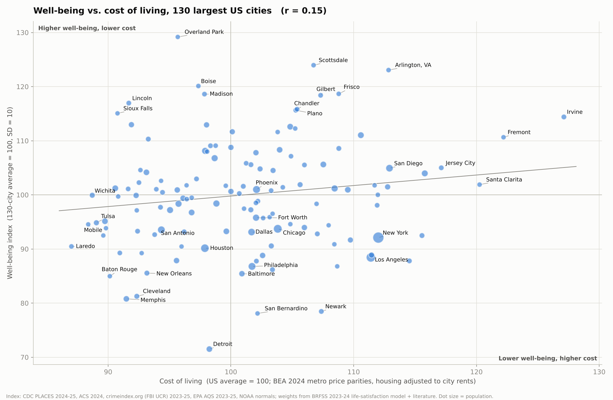
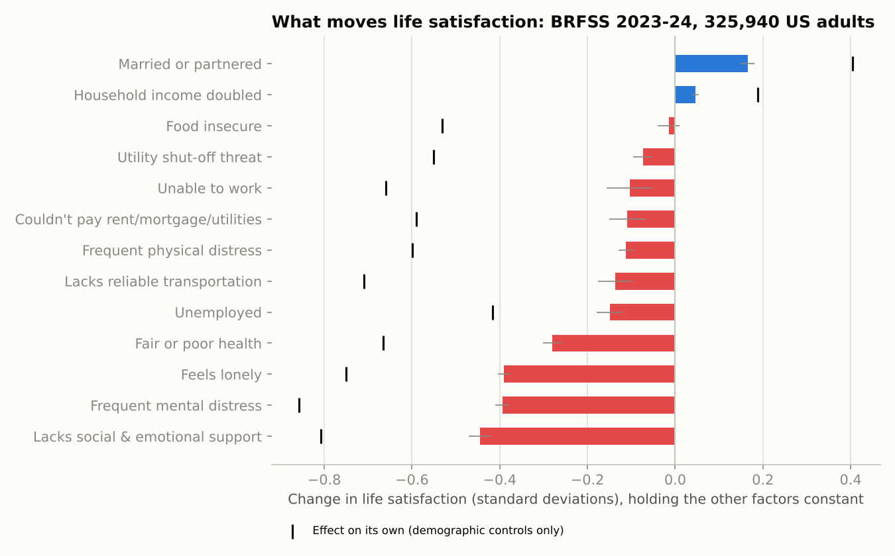

# US City Well-Being Index vs. Cost of Living

Interactive version: https://claude.ai/artifact/7dKv2TASQ2dRXT5idrF8kF (private until shared).



## Question

Which factors most affect quality of life and well-being? Can they be combined into a city-level
index? And how does that index compare with cost of living across US cities?

## What the evidence says

**Our own estimate.** We ran a survey-weighted regression of life satisfaction on the CDC
**BRFSS 2023–2024** microdata: 325,940 adults in the 39 states that asked "How satisfied are you
with your life?" The model controls for age, sex, race, education, and state × year. Effects
are shown in standard deviations of life satisfaction, holding the other factors constant.

| Factor | Effect (SD) | On its own | Chance of being dissatisfied |
|---|---:|---:|---:|
| Lacks social & emotional support | −0.45 | −0.81 | +8.4 pts |
| Frequent mental distress (14+ days/mo) | −0.39 | −0.86 | +11.3 pts |
| Feels lonely | −0.39 | −0.75 | +3.6 pts |
| Fair or poor health | −0.28 | −0.67 | +4.7 pts |
| Married or partnered | +0.17 | +0.40 | −1.8 pts |
| Unemployed | −0.15 | −0.42 | +5.5 pts |
| Lacks reliable transportation | −0.14 | −0.71 | +6.3 pts |
| Frequent physical distress | −0.11 | −0.60 | +2.8 pts |
| Couldn't pay rent/mortgage/utilities | −0.11 | −0.59 | +2.8 pts |
| Household income doubled | +0.05 | +0.19 | −0.1 pts |
| Food insecure | −0.02 | −0.53 | +1.3 pts |

The model's R² is 0.28. Social connection and mental health dominate. Income matters, but much
less than its raw correlation suggests once health, relationships, and hardship are held
constant.

These results match the research literature:
- Social relationships: Helliwell & Putnam (2004); Holt-Lunstad et al. (2010).
- Mental health ahead of income: Clark et al., *The Origins of Happiness* (2018).
- Unemployment hurts beyond lost pay: Clark & Oswald (1994).
- Income has log-shaped, diminishing returns: Kahneman & Deaton (2010).
- People judge their income against their neighbors': Luttmer (2005).

For place conditions the survey can't measure:
- Commuting: Kahneman et al. (2004); Stutzer & Frey (2008).
- Crime: Cohen (2008).
- Air pollution: Levinson (2012).
- Climate: Albouy et al. (2016).



## The index

The unit is the Census place (city limits). It covers all **130 cities** with 200,000+ residents
in ACS 2024.

| Domain | Weight | City measure | Source |
|---|---:|---|---|
| Social connection | 28% | Loneliness; lacking emotional support | CDC PLACES |
| Physical health | 18% | Fair/poor health; frequent physical distress | CDC PLACES |
| Economic security | 16% | Housing, utility, transport, and food hardship; unemployment | CDC PLACES, ACS |
| Mental health | 8% | Frequent mental distress | CDC PLACES |
| Safety | 15% | Log homicide rate + log violent-crime rate, 2023–25 | crimeindex.org (FBI UCR) |
| Commute | 7% | Mean commute time | ACS 2024 |
| Air quality | 4% | PM2.5, monitors within 25 km, 2023–25 | EPA AQS |
| Climate | 4% | Heating + cooling degree days | NOAA 1991–2020 normals |
| Purchasing power | 0% (optional) | Median household income ÷ local price level | ACS, BEA |

How the weights were set:
- **Resident domains (70%).** Each domain's raw score is the life satisfaction the BRFSS model
  predicts from the city's prevalences (Σ coefficient × prevalence). Weights are proportional
  to how much that prediction varies across the 130 cities. Mental distress has a large effect
  per person, but it varies little between cities, so mental health gets a smaller weight than
  social connection.
- **Place domains (30%).** Not measurable in BRFSS. These weights are a judgment informed by
  the studies above.

Each domain is z-scored across the cities, combined with the weights, and rescaled so the
city average is 100 and one SD is 10.

**Cost of living.** Uses BEA 2024 Regional Price Parities for the city's metro (US = 100). The
housing component (an implied 17% expenditure weight) is rescaled by the city's ACS median gross
rent relative to its metro's. The interactive chart can also show the unadjusted metro RPP.

## Results

- **Cost barely predicts well-being:** r = 0.15 (0.02 using the unadjusted metro RPP).
- **Top overall:** Overland Park, Scottsdale, Arlington VA, Boise, Frisco, Madison, Gilbert,
  Lincoln, Chandler, Plano.
- **Most well-being for the cost:** Overland Park, Scottsdale, Boise, Arlington VA, Madison,
  Lincoln, Gilbert, Frisco, Sioux Falls.
- **Lowest:** Detroit, San Bernardino, Newark, Memphis, Cleveland, Baton Rouge, Baltimore,
  New Orleans.
- **Big cities:** NYC 92, LA 88, Chicago 94, Houston 90, Philadelphia 87, Phoenix 101,
  San Diego 105, Seattle 111, Denver 113, Washington DC 106.

The rankings are robust to other weightings (`output/sensitivity.csv`). Spearman ρ with the
default ranking:

| Alternative weighting | ρ |
|---|---:|
| Equal weights | 0.965 |
| Resident domains only | 0.977 |
| 50/50 resident/place | 0.977 |
| "Very satisfied" coefficients | 0.993 |
| No climate | 0.997 |
| +10% purchasing power | 0.992 |

Full table: `output/city_rankings.csv`.

## Limitations

- **The index predicts well-being; it doesn't measure it.** No public source reports life
  satisfaction by city.
- **PLACES numbers are modeled.** They are small-area estimates built partly from each city's
  demographics. The index therefore describes how a city's residents are doing, which mixes
  place effects with who lives there. Affluent suburbs score high partly for that reason.
- **Some social-needs data is older or imputed.**
  - In the 2025 PLACES release, the social-needs measures are missing for TX, FL, TN, WA, and KY.
    These cities use the 2024 release (BRFSS 2022), linearly calibrated. Loneliness was asked
    differently in 2022 ("socially isolated"), so for these cities it is noisier (r = 0.64).
  - KY and PA health measures also come from the 2024 release.
  - For CO, OR, PA, and SD (7 cities), social-needs measures are imputed from other PLACES
    measures (cross-validated R² 0.69–0.97). These cities are flagged.
- **Crime rates use the reporting agency's own population.**
  - Las Vegas, Enterprise, and Spring Valley all use the Las Vegas Metro PD figures.
  - Honolulu's figure covers the whole island.
  - Moreno Valley and Santa Clarita use 2025 only. Orlando uses 2022 only, and New Orleans
    2022–23, because of gaps in later reporting.
- **Place weights are judgment.** The interactive page lets you change them.

## Reproduce

```
pip install -r requirements.txt
python scripts/01_extract_brfss.py      # needs raw/brfss_llcp_{2023,2024}/LLCP*.XPT (CDC BRFSS)
python scripts/02_brfss_weights.py      # life-satisfaction regressions
python scripts/03_build_city_data.py    # merge city indicators (needs raw/ downloads, see script)
python scripts/04_compute_index.py      # index, trend, sensitivity
python scripts/05_export_and_plot.py    # PNGs, rankings CSV, data bundle
python scripts/06_build_page.py         # interactive HTML page
```

The raw downloads (about 3.4 GB) are gitignored. Their sources:
- CDC: BRFSS LLCP 2023/2024 XPT files; PLACES place data (Socrata `eav7-hnsx`, `hbpe-6r8n`).
- Census: ACS 2024 1-year table-based summary files; 2024 place Gazetteer; OMB 2023 delineation
  list 2.
- BEA: `MARPP.zip`.
- EPA AirData: `annual_conc_by_monitor_YYYY.zip`.
- NOAA: 1991–2020 annual/seasonal normals archive.
- crimeindex.org: `historical_crime_1930_2025_*.csv`. Agency names are extracted from the site's
  JavaScript bundle into `data/rtci_agency_names.psv`.
